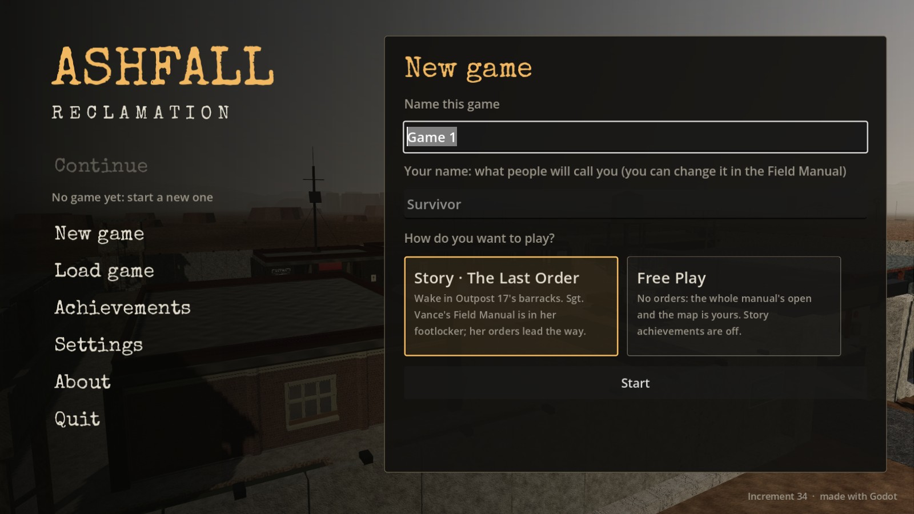
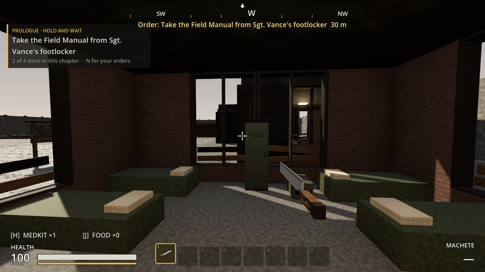
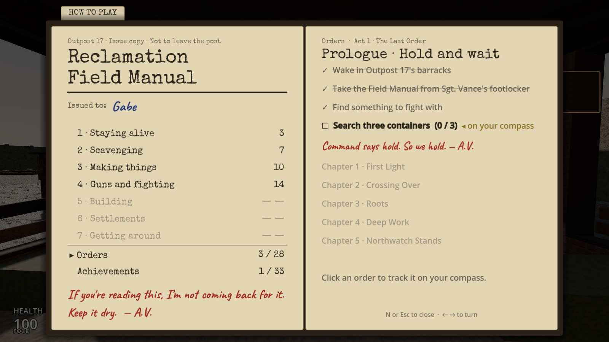
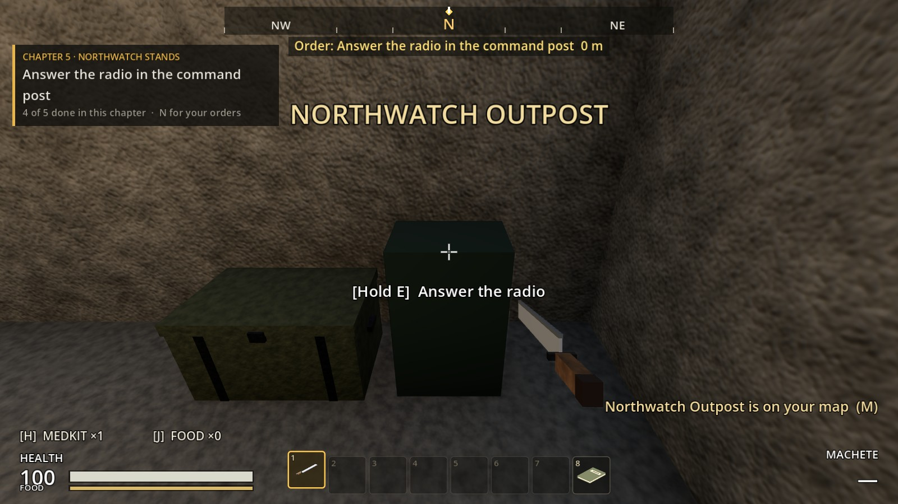
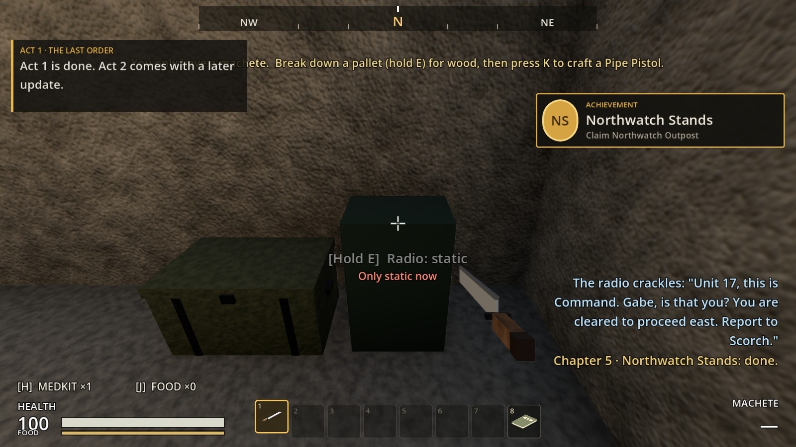
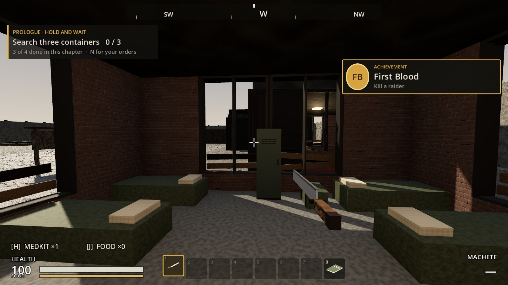
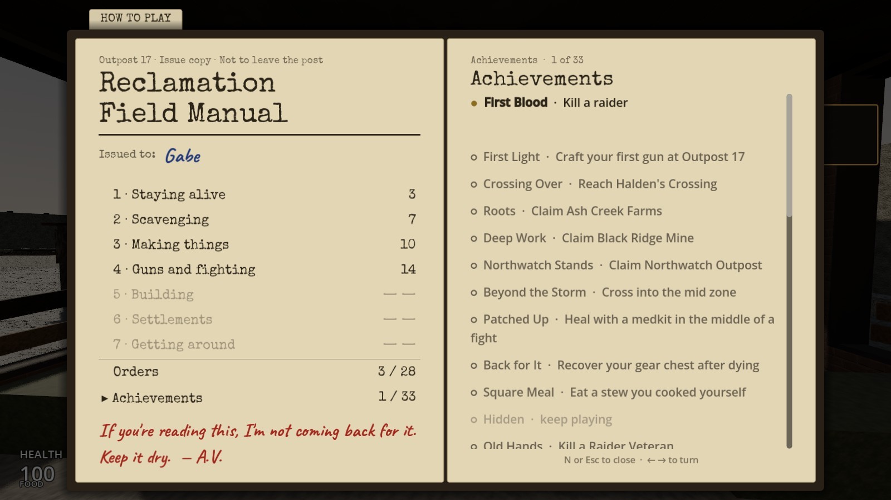
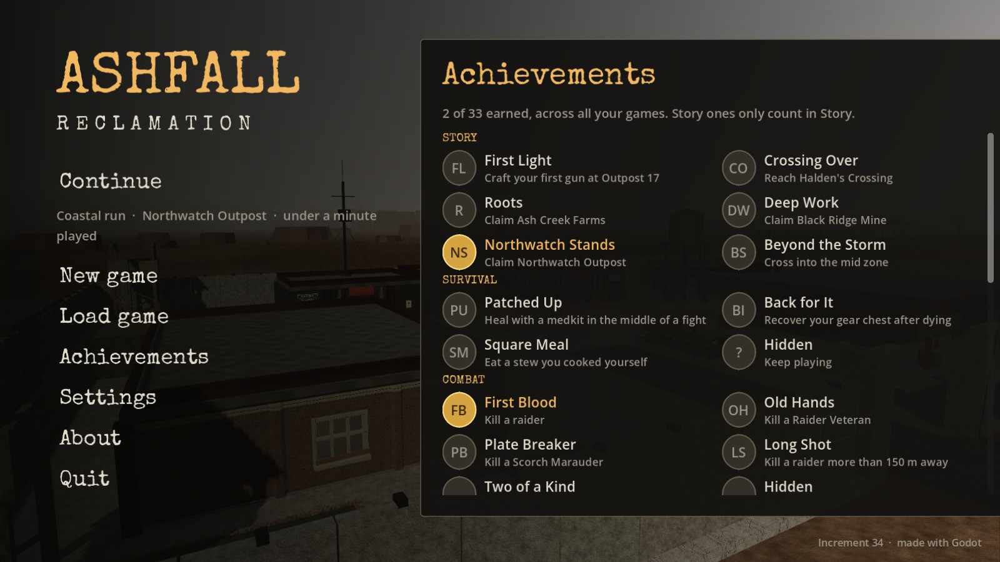
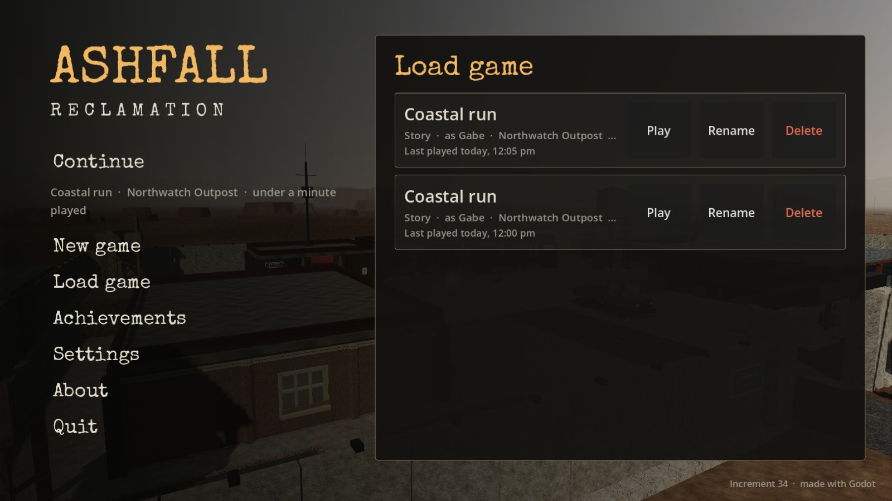

# Increment 34: orders and achievements, Story or Free Play

**Status:** in testing, 26 Nov 2026. Built from the approved proofs (Story: *The Last Order*; orders with no item rewards and a compass marker only for the order you track; 33 achievements; Free Play opens every chapter of the manual, with no orders and no story achievements).

## Story or Free Play

**New game** now asks how you want to play:
- **Story · The Last Order:** you wake in Outpost 17's barracks with your machete. Sgt. Vance's Field Manual is in her footlocker in the command post, and her orders lead the way.
- **Free Play:** you start where you always have, with the manual on slot 8 and **every chapter open**. There are no orders, and the six story achievements are off. The rest all count.

Each game's card on **Load game** says which it is: *"Story · as Gabe · Outpost 17 · …"*.

**Your game carries on in Story.** A game from before this update has Act 1 done as far as it's got: the chapters before the furthest one it shows any sign of are counted done, and so is whatever that chapter shows. It looks at places held, the pump, jobs and what you carry. Achievements it shows are caught up quietly, without toasts. A game that holds Ash Creek with its pump fixed picks up at *Chapter 3 · Roots*, with a Farmer to find.

## Orders

**Orders** are short tasks in chapters, one chapter at a time, from the proofs:

| Chapter | Orders |
|---|---|
| **Prologue · Hold and wait** | Wake in Outpost 17's barracks · Take the Field Manual from Sgt. Vance's footlocker · Find something to fight with · Search three containers |
| **1 · First Light** | Craft a pipe pistol by hand (K) · Make rounds at the workbench · Kill a raider · Heal with a bandage |
| **2 · Crossing Over** | Follow the road to Halden's Crossing · Climb the water tower and look around · Find Tomas in the diner · Clear the raiders at Halden's |
| **3 · Roots** | Clear Ash Creek's raiders · Claim the farm at its notice board · Fix the pump · Give someone the Farmer job · Arm a guard · See the farm through its first raid |
| **4 · Deep Work** | Drive the truck to Black Ridge Mine · Find Old Jeb in the bunkhouse · Clear and claim the mine · Put a Miner to work · Build the mine's palisade |
| **5 · Northwatch Stands** | Take Northwatch from its garrison · Claim it · Get an Armorer making guns · Hold all three places · Answer the radio in the command post |

**How they work:**
- **Each order ticks itself off** when the game sees it done. Anything already done counts, so you can't get stuck: make the pipe pistol before the Prologue's over and it's ticked the moment Chapter 1 starts.
- **No item rewards.** Finishing a chapter says so (*"Prologue · Hold and wait: done. Next: Chapter 1 · First Light"*), with a sound. Chapters 1 to 5 each earn their story achievement.
- **The tracker** (top left) shows the chapter, the order you're on with how far along it is (*"Search three containers 0 / 3"*) and how much of the chapter is done. It flashes green as an order's done and steps aside while a window's open. In Story the old *"You only have a machete…"* line gives way to it.
- **The compass marker:** only the order you track has one, a gold diamond named *"Order: …"* with its distance. It sits on the footlocker, the workbench, Halden's water tower, Tomas, the notice boards, the radio. Orders with nowhere to point (search three containers) have none.

**The Field Manual** has two new pages below its chapters: **Orders** and **Achievements**, each with a count.
- **The Orders page** lists this chapter's orders, with the done ones struck out and Vance's note in red pen underneath. **Click an order to track it**, and the marker moves to it. The chapters done are ticked, and the ones to come are greyed.
- **N** opens the manual where you left it, so on the Orders page if that's where you were.

## The radio

| | |
|---|---|
|  |  |

Northwatch's command post radio is the act's last order. It's static until the rest of Chapter 5 is done, saying *"Only static. Hold Northwatch, and all three places, first"*. After that, hold **E** to answer:

> The radio crackles: "Unit 17, this is Command. Gabe, is that you? You are cleared to proceed east. Report to Scorch."

That finishes Act 1. The tracker says *"Act 1 is done. Act 2 comes with a later update."* In Free Play the radio is only static. Act 1's story beats through the chapters are Increment 35; this reply is the one line done now.

## Achievements

**The 33 achievements** listed on the menu since 33.1 now count.
- **Earning one:** a toast shows it, top right, with a gold medal, its name and what it was for. More than one at a time wait their turn.
- **Per game:** each game keeps its own, and the manual's Achievements page lists them.
- **On the menu:** the **Achievements** page shows everything earned across all your games, with the medals lit (*"2 of 33 earned, across all your games"*).
- **Hidden ones** stay *"Hidden"* until earned.

| | |
|---|---|
|  |  |

**What counts, briefly:**
- **Story:** the five chapters, plus Beyond the Storm when you cross into the mid zone.
- **Survival:** a medkit while you're in a fight (hurt in the last 12 s, or a raider after you within 35 m); your gear chest emptied; a stew you cooked yourself; walking out of the storm with under 10 health.
- **Combat:** a kill, a Veteran, a Marauder, a kill over 150 m, two different pistols within 10 s, the truck.
- **Crafting:** a pipe pistol by hand, a gun at the weapons bench, three attachments, head, body and legs armour.
- **Settlements:** the pump, 50 vegetables, an armed guard, a raid with nobody wounded, twelve settlers, four kinds of animal, a reinforced palisade, three places held.
- **Exploring:** all seven places, three quarters of the map, Halden's water tower, 10 km driven, running the truck dry more than 1 km from fuel.

## The playtest

In a real window:
- **The menu:** on New game, picked Story.
- **The start:** woke in the barracks. The tracker read *"Take the Field Manual from Sgt. Vance's footlocker"*, and the compass marker pointed at the footlocker 30 m away.
- **The manual:** took it, and the order ticked to *"Search three containers 0 / 3"*. Opened the manual on its Orders and Achievements pages.
- **A toast:** earned First Blood, and the toast showed top right.
- **The radio:** with the rest of Act 1 done, went to Northwatch's radio and answered it. Command answered, Act 1 was done, and Northwatch Stands was earned.
- **The menu again:** saved and went back to it. Achievements showed two earned, and Load game showed the card in Story.

## How it's built

- **The orders:** `scripts/story/orders.gd` (`Orders`) holds the chapters and orders as data. Each order has a `check` and, optionally, a `count` and a `where` (a node path in the zone, or `survivor:<name>`).
- **The story itself:** `scripts/player/story_progress.gd` (`StoryProgress`) is a child of the player, saved as `"story"`.
  - **What it tracks:** the mode, the orders done, the one tracked, the achievements earned and the stats behind them.
  - **How it hears about things:** the player's signals (crafting, containers, items used, talking to people, damage), raiders dying (`StoryProgress.on_raider_killed`), raids ending, and the gear chest.
  - **How it checks:** twice a second it looks at the world (claims, jobs, where you stand, the truck), ticks orders and moves the marker. The marker is a `Landmark` with no radius, so it's never a place.
- **On screen:**
  - `scripts/ui/order_tracker.gd` (`OrderTracker`) and `scripts/ui/achievement_toast.gd` (`AchievementToast`), made by the HUD;
  - the manual's Orders and Achievements pages: `FieldManualScreen.orders_text()` and `achievements_text()`.
- **The radio:** `scripts/story/story_radio.gd` (`StoryRadio`), an `Interactable` on Northwatch's comms radio. `tools/add_story_radio.gd` puts it in `levels/northwatch_outpost/northwatch_outpost.tscn`; run it again after `build_sites.gd`.
- **New games:**
  - `SaveManager.start_new_game(name, your_name, mode)` takes `"story"` or `"free_play"`, then calls `StoryProgress.begin()`.
  - The game's card records its `"mode"` and `"achievements"` for the menu.
  - `MainMenu.earned_everywhere()` gathers them.
- **Small changes:**
  - `Landmark.at()` skips markers with no radius.
  - The old machete hint shows only in Free Play.

## Tests

- **New:** `tests/test_orders.gd` (9):
  - the orders from the proofs;
  - ticking off one chapter at a time;
  - tracking an order;
  - the tracker and the manual page;
  - a new Story game (the barracks, the footlocker, the marker);
  - Free Play;
  - a game from before carrying on;
  - the radio;
  - saving and loading.
- **New:** `tests/test_achievements.gd` (5):
  - the 33;
  - earned once, with a toast;
  - what you do;
  - Free Play has no story ones;
  - the game's card and the menu.

## Next

**Increment 35:** Act 1's story beats through the chapters (claiming Ash Creek, the mine and Northwatch).
